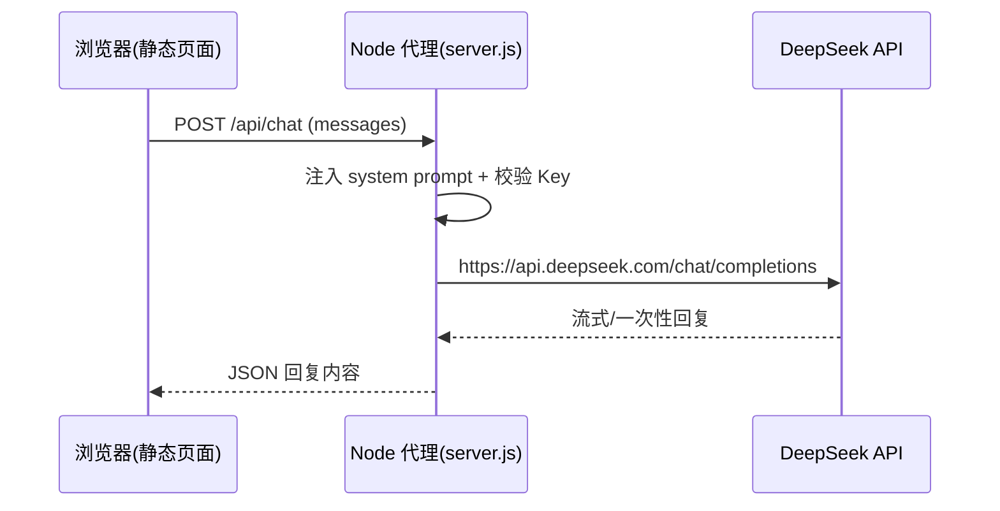

## 产品概述
为承佳豪打造一个「简约高级」的个人主页，采用瑞士网格极简解构版式，以蓝色为主色，并适配手机端。页面包含头像、姓名与一句话介绍、个人信息展示区，以及一个可以提问的数字分身聊天区。

## 核心功能
- 头像与身份区：占位头像（首字母「承」）、姓名「承佳豪」、一句话介绍「不满足安于现状，执着于追求成长与进步」
- 个人信息展示区：展示身份（即将毕业的本科生）、正在做的事（学习 AI、学习拍照）、兴趣标签（健身、穿搭、音乐、拍照）、记忆点（外表极具攻击性，内心却善良）
- 数字分身聊天区：访客可向「承佳豪的数字分身」提问并获得真实对话回复，提供三个快捷提问入口
- 响应式布局：桌面端采用多列网格与不对称解构排版，手机端自动切换为单列堆叠

## 页面结构
- 顶部导航：姓名标识 + 简洁章节导航
- Hero 区：占位头像 + 姓名 + 一句话介绍
- 个人信息展示区：用简洁网格卡片与标签呈现身份、正在做、兴趣、记忆点
- 数字分身聊天区：对话消息区 + 输入框 + 发送按钮 + 三个快捷提问按钮


## 技术栈
- 前端：纯静态 HTML + CSS + JavaScript（无框架、无构建工具）
- 后端：Node.js 内置 http/https 模块编写的零依赖代理服务（已确认环境为 Node v24.22.1）
- AI 接口：DeepSeek Chat Completions（OpenAI 兼容格式，国内直连）
- 配置管理：API Key 通过环境变量 `DEEPSEEK_API_KEY` 读取，支持同目录 `.env` 文件

## 实现方案

### 总体策略
采用「静态前端 + 极简后端代理」结构：前端用瑞士网格极简解构版式渲染单页，聊天请求通过 `POST /api/chat` 发送到本地 Node 服务，由服务端注入 DeepSeek API Key 后转发，避免 Key 暴露在浏览器。整个项目无 npm 依赖、无数据库、无登录，双击或 `node server.js` 即可预览。

### 系统架构



### 模块划分
- **静态资源服务**：server.js 托管 index.html / styles.css / script.js
- **聊天代理接口**：server.js 提供 `/api/chat`，转发 DeepSeek 请求
- **页面结构层**：index.html 定义四大区块语义结构
- **样式层**：styles.css 实现瑞士网格、蓝色主题与响应式断点
- **交互层**：script.js 处理消息渲染、发送、快捷提问与错误状态

### 数字分身人设（system prompt 要点）
- 身份设定：你是「承佳豪」的数字分身，即将毕业的本科生
- 近期在做：健身、学习 AI、学习拍照
- 擅长与关心：换位思考、共情他人；关心自身成长
- 记忆点：外表极具攻击性、内心善良
- 语气：真诚、有温度、简洁、不浮夸

### 三个快捷提问（由数字分身视角拟定）
1. 你马上毕业了，接下来有什么规划？
2. 你是怎么开始学 AI 和拍照的？为什么选这两件事？
3. 听说你外表挺有攻击性的，跟你相处起来是什么感觉？

## 实现细节

### 目录结构
```
personal/
├── index.html      # [NEW] 页面语义结构：导航 / Hero / 个人信息区 / 聊天区，含所有文案内容与占位头像
├── styles.css      # [NEW] 瑞士网格极简版式：网格系统、大字号标题、留白、编号章节、蓝色主题、响应式断点
├── script.js       # [NEW] 聊天交互：消息渲染、发送、fetch 调用 /api/chat、三个快捷提问、loading 与错误态
├── server.js       # [NEW] 零依赖后端：静态文件托管 + POST /api/chat 转发 DeepSeek + 读取 DEEPSEEK_API_KEY/.env
├── .env.example    # [NEW] 配置示例：DEEPSEEK_API_KEY= 占位说明
└── README.md       # [NEW] 启动说明：如何配置 Key、启动服务、打开预览地址
```

### 关键接口约定
- `POST /api/chat`，请求体 `{ messages: [{ role, content }] }`，响应体 `{ reply: string }`；后端拼接 system prompt 后转发 DeepSeek，模型默认 `deepseek-chat`
- 前端未配置 Key 或请求失败时，展示可读的提示信息（不抛未捕获异常）

### 实现注意事项
- **安全**：API Key 只存在服务端环境变量或 `.env`，任何情况下不写入前端代码、不返回给浏览器
- **零依赖**：server.js 仅用 Node 内置模块（http、https、fs、path、url），不安装 npm 包
- **性能**：聊天采用一次性完整回复（原型阶段不引入流式，避免复杂度）；静态文件用简单路径映射，不引入缓存层
- **健壮性**：对缺失 Key、DeepSeek 非 200 响应、请求体为空等情况做边界处理并返回友好错误
- **可扩展性**：DeepSeek 的 base URL、模型名集中在 server.js 顶部常量，便于后续更换模型或扩展流式输出


## 设计风格
采用瑞士国际主义风格（Swiss / International Typographic Style）的极简解构版式：强网格对齐、大字号标题、充足留白、克制的细分割线与章节编号（01/02/03），通过不对称构图制造秩序中的张力。整体以白色为底、近黑文字、单一品牌蓝作为强调色，营造简约高级、冷静克制的氛围。

## 页面设计
- 顶部导航：左侧「承佳豪」标识，右侧极简锚点导航，底部一条细分割线
- Hero 区：左对齐大字号姓名与一句话介绍，占位头像（圆形首字母「承」）置于对侧，形成不对称解构布局
- 个人信息区：网格卡片，用「身份 / 正在做 / 兴趣 / 记忆点」四组编号区块呈现，兴趣用蓝色描边标签
- 聊天区：卡片式对话面板，消息气泡左右区分，底部输入框 + 发送按钮 + 三个快捷提问胶囊，带加载与错误状态
- 响应式：桌面端双列网格，手机端单列堆叠，导航与头像布局自适应

## 交互与动效
- 按钮与卡片 hover 时轻微上浮与蓝色描边过渡
- 发送消息时出现加载动画，消息以平滑过渡插入
- 快捷提问点击后自动填充并发送
